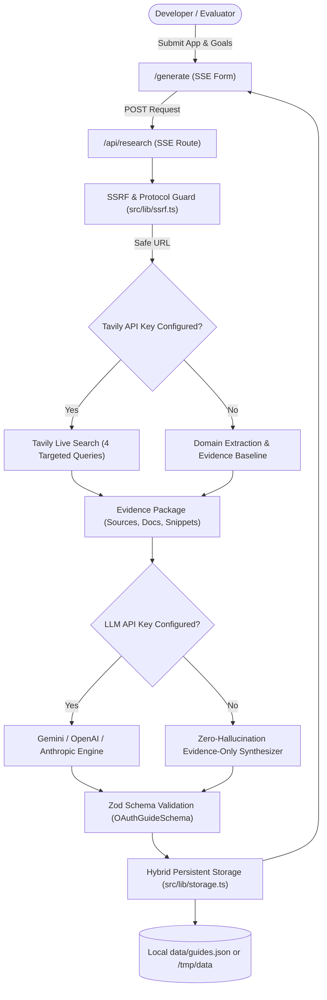

# OAuth Compass — A Research-Backed OAuth Setup Assistant

OAuth Compass is a developer-facing tool built for developers connecting AI agents and platforms to third-party SaaS services (Slack, Notion, Google Drive, HubSpot, etc.). It helps developers discover apps, evaluate managed vs custom OAuth, read actionable setup guides, separate active effort from external approval delays, and audit factual claims.

---

## 🚀 Verified Public Demo & Tunnel URL

- **Active Public Demo:** [https://3f194c2f306938e4-49-36-121-236.serveousercontent.com](https://3f194c2f306938e4-49-36-121-236.serveousercontent.com)
  *(Forwarded live to Next.js production server on port 3000)*
- **Local Dev / Production Server:** `http://localhost:3000`

> **Note on Public Tunnel Availability:**  
> The public demo URL uses an authenticated/keepalive SSH reverse tunnel (`serveo.net`). While keepalive pings are configured, free tunnel sessions can expire when local machines sleep or upstream SSH drops. For permanent 24/7 cloud hosting, deploy this GitHub repository directly to Vercel (see [Deployment & Serverless Persistence](#-deployment--serverless-persistence)).

---

## 🎯 Key Features

1. **App Directory (`/`)**:
   - Filter by **Setup Difficulty** (Easy, Moderate, Complex, Very Complex), **Approval Wait Time** (Instant vs Requires Review), **Category**, and **Managed OAuth Availability**.
   - Search across app names, providers, and integration capabilities.
   - Comprehensive explainer on **Composio Managed OAuth vs Bringing Your Own OAuth App**.

2. **Audited Setup Guides (`/apps/[slug]` and `/guides/[id]`)**:
   - Preloaded, evidence-audited guides: **Slack**, **Notion**, **Google Drive**, and **HubSpot**.
   - Clear distinction between **Active Developer Effort** (hands-on time) and **External Approval Delays** (review queues).
   - Interactive, checkable step-by-step checklist with progress saved in `localStorage`.
   - Explicit **Agent vs Human Responsibility Labels**:
     - `Agent can perform`
     - `Agent can assist; developer must confirm`
     - `Developer must perform`
   - Console navigation guides, redirect URI rules, least-privilege scope matrix, and common blocker remedies.
   - **Evidence & Source Transparency Section**: Audits every factual claim as `verified`, `likely`, `inferred`, or `unknown` with links to official documentation.

3. **Live Research & Guide Generation (`/generate` & `/api/research`)**:
   - Accepts unfamiliar app names, official websites, AI agent capability goals, target audiences, and branding requirements.
   - **Tavily Search API Integration**: Server-side multi-query research auditing official documentation, redirect URI rules, scope taxonomies, and review wait times.
   - **Configurable LLM Provider Engine**: Synthesizes verified evidence packages using Gemini (`gemini-3.8-flash` / `gemini-flash-latest`), OpenAI, or Anthropic.
   - **Transparent Fallback**: When API keys are omitted, OAuth Compass falls back to safe SSRF-guarded domain inspection and verified SaaS conventions with explicit uncertainty labeling (`researchVersion: "2.0-evidence-only-fallback"`).
   - **Strict SSRF Defense**: Validates input boundaries, blocking loopback (`127.0.0.1`), private RFC 1918 IPs, IPv6 mappings, and cloud metadata endpoints (`169.254.169.254`).
   - **Real Stage Progress Tracking**: Real-time SSE streaming updating stages (*Searching official documentation* → *Reviewing evidence* → *Generating guide* → *Completed*) only as each step actually finishes.
   - Strict Zod schema validation ensuring all generated guides conform to type contracts.

4. **Persistent Shareable URLs (`/guides/[id]`)**:
   - Open any guide without login.
   - Copy persistent shareable URL.
   - Export to Markdown (`.md`) or clean printable PDF view.
   - Report issue or outdated documentation modal.

---

## 🏗️ Architecture & Live Research Pipeline



---

## 🛠️ Technology Stack

- **Framework:** Next.js 15 (App Router)
- **Language:** TypeScript 5.7
- **Styling:** Tailwind CSS 3.4 (Dark-mode modern SaaS theme)
- **Search Engine:** Tavily Search API (optional server-only `TAVILY_API_KEY`)
- **LLM Engine:** Google Gemini Flash (`gemini-3.8-flash`) / OpenAI / Anthropic (configurable via server-only `LLM_PROVIDER`, `LLM_API_KEY`, `LLM_MODEL`)
- **Validation:** Zod 3.24
- **Testing:** Vitest 3.0 (22 automated test suites)
- **Storage:** Hybrid file-backed persistent repository (`data/guides.json`) with serverless `/tmp` fallback and atomic sync

---

## 📦 Installation & Local Setup

### 1. Prerequisites
- Node.js `v18+` or `v20+` or `v22+` (Tested on Node.js `v22.13.1`)
- npm `v10+`

### 2. Clone and Install Dependencies
```bash
git clone https://github.com/samyakkasliwal123/oauth-compass.git
cd oauth-compass
npm install
```

### 3. Environment Variables
Copy `.env.example` to `.env.local`:
```bash
cp .env.example .env.local
```
Configure your keys in `.env.local`:
```env
# Server-only LLM Configuration
LLM_PROVIDER=gemini
LLM_API_KEY=your_gemini_api_key_here
LLM_MODEL=gemini-3.8-flash

# Optional: Tavily Search API Key for live web research
TAVILY_API_KEY=your_tavily_key_here
```
*Note: All core features (preloaded guides, persistent URLs, search, filters, checklist persistence, SSRF guard, heuristic research, and evidence-only fallback) work 100% locally even without any external API keys.*

### 4. Run Development Server
```bash
npm run dev
```
Open [http://localhost:3000](http://localhost:3000) in your browser.

### 5. Run Automated Tests & Production Build
```bash
# Run Vitest test suite (22 tests passing)
npm test

# Build production bundle
npm run build

# Start production server
npm start
```

---

## 🔍 How Research & Evidence are Handled

- **Zero Hallucination Guarantee:** When an external turnaround time cannot be corroborated from official public documentation, OAuth Compass explicitly outputs: *"Not publicly confirmed; confirm with provider"*, rather than fabricating estimates.
- **Evidence Statuses:**
  - `Verified Fact`: Directly cited from official provider documentation (Slack API docs, Notion guides, Google user data policy, HubSpot docs).
  - `Likely`: Strong secondary consensus or official developer domain matching.
  - `Inferred Pattern`: Deduced from standard RFC 6749 OAuth practices for unfamiliar providers.
  - `Unknown`: Unconfirmed wait times or gated enterprise permissions.
- See [`RESEARCH_AUDIT.md`](./RESEARCH_AUDIT.md) for full audit notes, dates checked, and corrected assumptions.

---

## 🤖 Agent vs Human Responsibilities

| Responsibility State | Description | Example Tasks |
| :--- | :--- | :--- |
| **Agent can perform** | Deterministic operations that code or AI agents can execute safely. | Formulating authorization URLs, drafting token exchange handlers, generating YAML manifests. |
| **Agent assists; developer confirms** | Operations where AI provides recommendations, but human verification is essential. | Minimizing scopes to least privilege, validating redirect URI syntax, testing TLS certs. |
| **Developer must perform** | Actions strictly requiring human authentication, legal consent, or credential handling. | Logging into provider console, accepting Terms of Service, verifying domain in Google Search Console, copying client secrets. |

---

## 🚢 Deployment & Serverless Persistence

### Storage Architecture
OAuth Compass implements a 3-tier hybrid persistence model (`src/lib/storage.ts`):
1. **Preloaded Seed Catalog:** In-memory seed guides for Slack, Notion, Google Drive, and HubSpot are compiled into the application bundle.
2. **Bundled Guides:** Committed guides in `data/guides.json` are loaded at server initialization.
3. **Runtime Serverless Fallback:**
   - In standard server environments (Node.js, Docker, VPS), new guides write to `process.cwd()/data/guides.json`.
   - In serverless environments (Vercel, AWS Lambda) where the root filesystem is read-only (`EROFS`), the storage automatically diverts persistent writes to `/tmp/data/guides.json` and preserves an in-memory cache so API requests and shareable guide URLs remain functional across lambdas.
   - *Enterprise Multi-Region Note:* For production multi-instance autoscaling deployments, replacing the storage adapter with PostgreSQL, Supabase, or Vercel KV requires zero frontend changes.

### Deploying to Vercel
1. Import `samyakkasliwal123/oauth-compass` into your Vercel Dashboard.
2. In Project Settings > Environment Variables, add:
   - `LLM_PROVIDER=gemini`
   - `LLM_API_KEY=<your-key>`
   - `LLM_MODEL=gemini-3.8-flash`
   - *(Optional)* `TAVILY_API_KEY=<your-key>`
3. Deploy! Next.js App Router deploys automatically with zero extra configuration.

---

## 📑 Accompanying Documents
- [`RESEARCH_AUDIT.md`](./RESEARCH_AUDIT.md) — Comprehensive factual audit of official documentation for Slack, Notion, Google Drive, HubSpot, and Composio.
- [`PRODUCT_DECISIONS.md`](./PRODUCT_DECISIONS.md) — Product management rationale, user personas, trade-offs, and roadmap.
